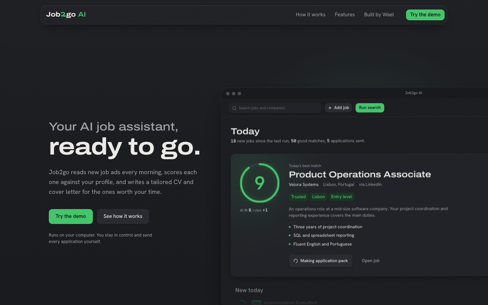
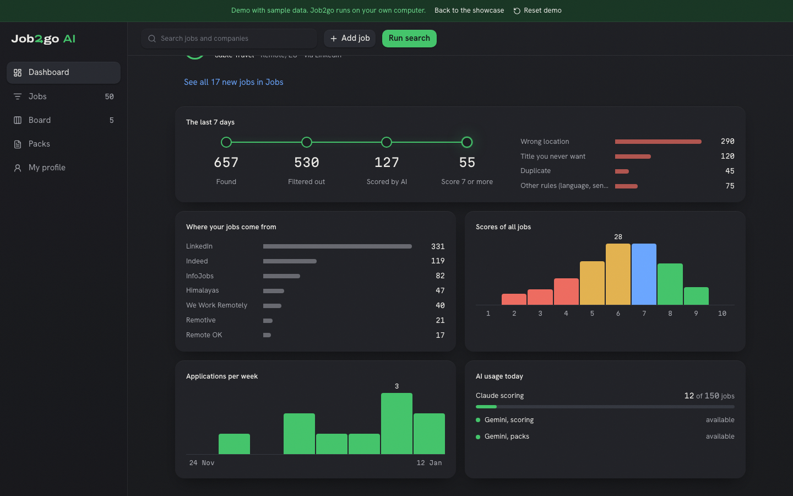
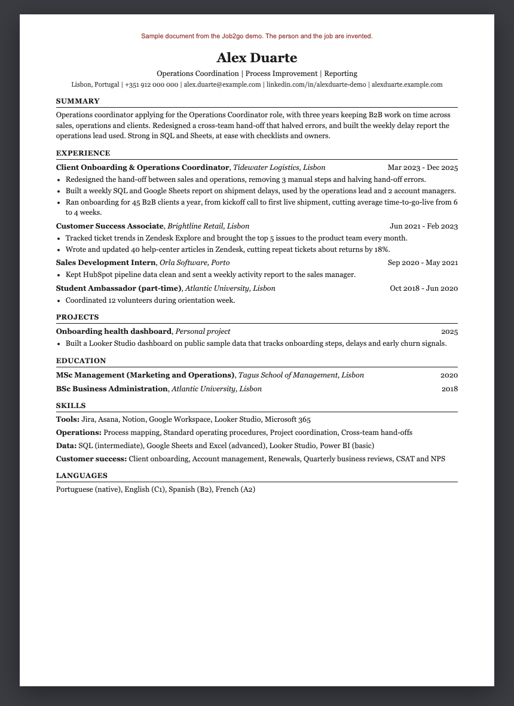

# Job2go AI

**Your AI job assistant, ready to go.** Job2go is a personal job-search agent that runs on your own
computer. Every morning it reads new job ads from LinkedIn, Indeed, InfoJobs and four remote job boards,
drops the ones that can never fit you, scores the rest from 1 to 10 against your profile with plain
reasons, and writes a tailored CV, cover letter and interview prep for the jobs you pick. You stay in
control: nothing is ever sent for you.

**Live demo:** _link coming soon_ (to deploy your own: import the repo in Vercel with Root Directory `web`) (the showcase and a clickable demo with invented data)



## Features

- **Scores you can read.** Every job gets a score from 1 to 10 with strengths, things to learn, red flags
  and unknowns. The AI only judges fit; clear rules in code (languages, location, level) adjust it.
- **A pack for every job.** A tailored one-page CV, a cover letter and an interview prep sheet, built
  only from facts in your profile. A strict "recruiter review" step scores each pack, and you can remake it.
- **Your board.** Drag jobs from New to Applied, Interview and Offer.
- **Learn what's missing.** A learning guide with free courses and videos for the skills a job asks for.
- **Runs on your laptop.** Your profile, CVs and applications are stored locally, never on a Job2go server.

| Dashboard | A tailored CV (demo data) |
|---|---|
|  |  |

## How it works

```
 job sites ──► free filters ──► AI score + rules ──► you pick ──► tailored pack ──► you apply
 (JobSpy,      (location,        (Gemini; Claude      (web app)    (CV, letter,      (yourself)
  remote        language, title,  as backup)                         prep, review)
  boards)       duplicates)
```

1. **Search** (`run.py`, `agent/search.py`, `agent/remote_sources.py`): Indeed and LinkedIn through
   [JobSpy](https://github.com/speedyapply/JobSpy), plus the public feeds of Remotive, Remote OK,
   Himalayas and We Work Remotely (each job links back to its source).
2. **Filter for free** (`prefilter.py`, `agent/dedupe.py`): wrong city, titles you never want,
   languages you don't speak, duplicates. No AI is used here.
3. **Score** (`agent/scoring.py`, `llm.py`): the AI returns a fit score and fixed-choice fields as
   structured JSON; `apply_rules()` then adjusts the score in code, so the rules are predictable.
4. **Pack** (`tailor.py`, `agent/pack_prompts.py`, `render_pack.py`): job analysis and a match map
   (duty -> your best evidence), writing, code checks, then a recruiter review that scores the result.
5. **Your app** (`serve.py` + `web/`): a local web app with Dashboard, Jobs, Board, Packs and My profile.

## Tech stack

- **Agent:** Python, pandas, pydantic, JobSpy, Google Gemini API, Claude (through the `claude` CLI), python-docx.
- **Web app:** React, TypeScript, Vite, Tailwind CSS, shadcn/ui, Motion.
- **Data:** a CSV tracker and an Excel file, on your computer.

## Run it on your computer

You need Python 3.11+, Node 20+, your **own** free [Gemini API key](https://aistudio.google.com) and,
optionally, your own Claude account with [Claude Code](https://claude.com/claude-code) installed (used
first for packs). Usage counts against your own allowances.

```bash
git clone https://github.com/Waelbenh/job2go.git && cd job2go
python3 -m venv .venv && .venv/bin/pip install -r requirements.txt
cp profile.example.yaml profile.yaml        # then write your own profile
cp secrets.example.yaml secrets.yaml        # then paste your Gemini key
(cd web && npm install)
.venv/bin/python run.py                     # first search + scoring
scripts/job2go.sh                           # starts everything and opens http://localhost:5173/app
```

`config.yaml` is an example for an invented person in Lisbon. Change the `home` block (your city, country
and university), the searches, the places and the languages to yours: the code itself names no city.

## Privacy

Everything runs on your computer. `profile.yaml`, `secrets.yaml`, `.env` and the `data/` folder are in
`.gitignore`. Only the text of a job ad and the parts of your profile it needs are sent to the AI
provider you configured, and only when a job is scored or a pack is made. The online demo uses no AI
and only invented data.

## Built by Wael

I'm fascinated by AI agents: software that doesn't just answer questions but gets real work done. I built
Job2go during my own job search to do the repetitive part, while I keep every decision.

[LinkedIn](https://www.linkedin.com/in/waelbenhaddou) · [GitHub](https://github.com/Waelbenh)

Logos and names of job sites belong to their owners; Job2go is not affiliated with them.
